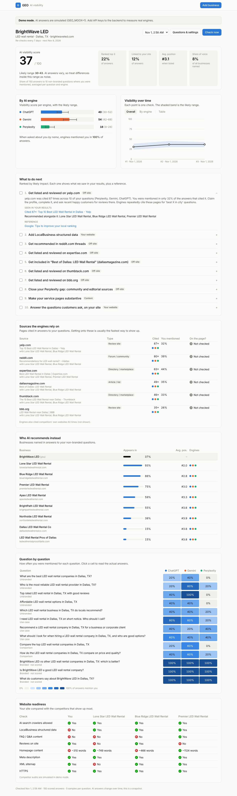

# GEO: AI visibility for local businesses

Find out how often ChatGPT, Gemini and Perplexity recommend a business, who they recommend instead, which sources they rely on, and what to do about it.



## What it does

1. **Onboarding.** Enter a website. GEO reads it to infer the business name, category and service area, then proposes 12–13 customer questions (unbranded, use-case, comparison and branded). The owner edits and confirms them.
2. **Measurement.** Each question goes to each engine several times (5 by default), always in the engine's **search-grounded** mode (OpenAI `web_search`, Gemini with Google Search grounding, Perplexity Sonar). That matches what consumers actually see.
3. **Extraction.** Each answer becomes an ordered list of businesses. GEO records whether the business was mentioned, its position, whether it was linked, and every source the engine cited.
4. **Scoring with honest uncertainty.**
   - The visibility score is the mention rate averaged over each question × engine cell.
   - The likely range comes from a cluster bootstrap that resamples whole questions.
   - Branded questions are reported separately and are not scored.
5. **Source-gap analysis.** For the pages the engines cite (Yelp, Reddit threads, "best of" lists, directories), GEO shows how often each was cited, which competitors appeared alongside it, and whether the business is named on the page.
6. **Recommendations.** These are ranked and evidence-backed. Each one carries at least one observed item from the run, and where one exists, a primary-source reference from a small curated technique library (`backend/app/pipeline/techniques.py`).
7. **Site audit.** GEO checks AI crawler access in robots.txt, LocalBusiness schema, FAQ content, reviews, sitemap and content depth, and compares them against the top competitors.
8. **Tracking.** Automatic re-checks run on a schedule (weekly by default), and a trend chart shows whether changes are working.

## Quick start

Requirements: Python 3.11+, [uv](https://docs.astral.sh/uv/), Node 20+.

```bash
make install
```

Try it offline with simulated AI answers (no API keys):

```bash
make demo
```

Then open http://localhost:3000.

### With real engines

```bash
cp backend/.env.example backend/.env
```

Add at least one of `OPENAI_API_KEY`, `GEMINI_API_KEY` or `PERPLEXITY_API_KEY`. Engines without a key are skipped. Then run each server in its own terminal:

```bash
make api
```

```bash
make web
```

### Docker

```bash
docker compose up --build
```

## Cost

One check = questions × engines × samples. The default of 12 scored questions × 3 engines × 5 samples is 180 answers, plus one cheap extraction call per answer. Lower `SAMPLES_PER_QUERY` for cheaper (noisier) checks.

## Architecture

```
frontend/  Next.js 15 dashboard (proxies /api to the backend)
backend/   FastAPI + SQLAlchemy (SQLite), in-process job queue and scheduler
  app/pipeline/
    profile.py     website → business profile → suggested questions
    engines/       live engines (search-grounded) + mock engine
    extract.py     answer → ordered businesses, target position/link (LLM, heuristic fallback)
    scoring.py     visibility, bootstrap ranges, competitor aggregation
    sources.py     cited-source rollup, classification, listing checks
    scrape.py      site fetch/parse + AI-readiness audit
    techniques.py  curated technique library with references
    recommend.py   evidence-backed, ranked recommendations
    runner.py      runs one check end to end
  app/worker.py    job queue, scheduled re-checks, restart recovery
```

The schema already has `owner_id` on businesses for multi-tenancy. The job queue is in-process; for multiple instances, swap it for Redis + arq/RQ (`execute_run` is self-contained).

## Tests

```bash
make test
```

## Known limitations

- API answers with search enabled are close to, but not identical to, the consumer apps (which add personalization, memory and exact location).
- Many directories block bots, so "is the business listed on this page" is often unknown.
- Microsoft Copilot and Google AI Overviews have no official API and are not measured.
- Engine model names change often; set them in `.env`.
